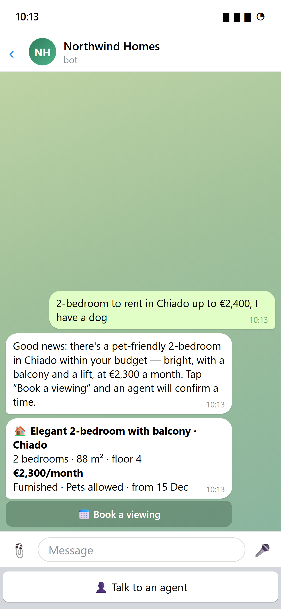
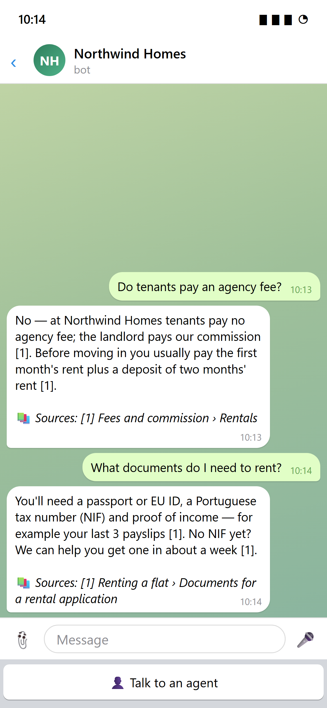
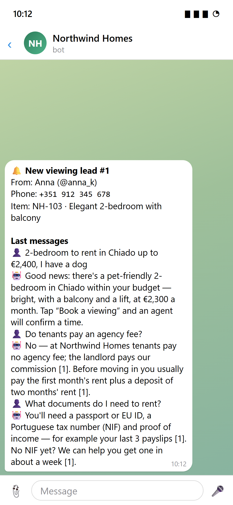
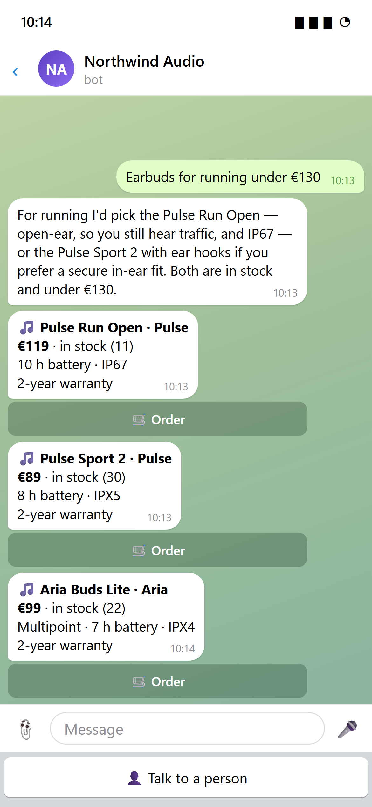
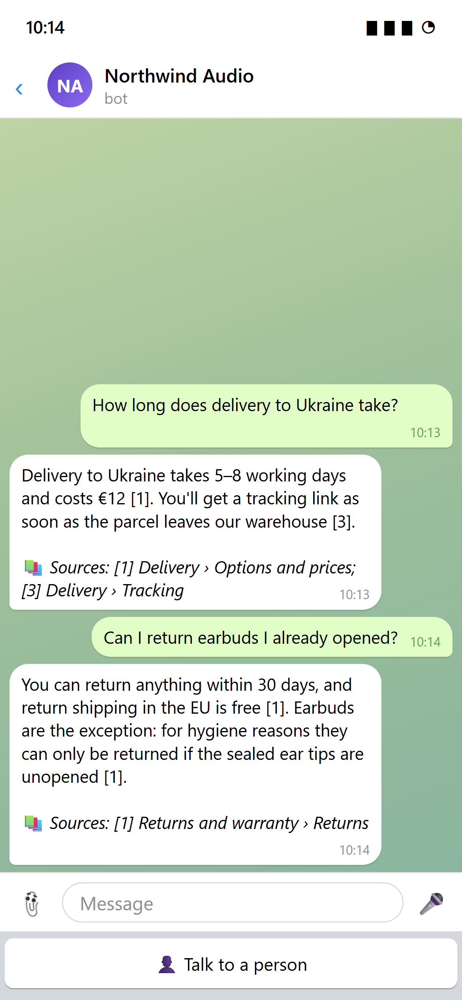
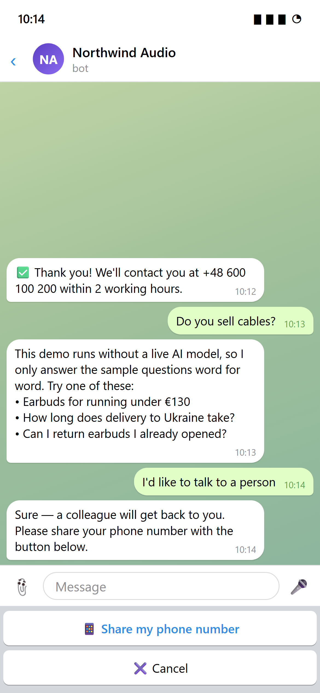

# Telegram AI Assistant: RAG + Function Calling

One assistant engine, two ready-made businesses:

- **Northwind Homes** — a real estate agency assistant: answers questions about fees, documents and viewings from the
  agency's own documents, finds flats from a free-text request ("2 bedrooms in Chiado up to €2,400, I have a dog"),
  books viewings.
- **Northwind Audio** — an online store assistant: recommends products for a need ("earbuds for running under €130"),
  answers delivery, payment, return and warranty questions, takes order requests.

Switching business = `VERTICAL=realty` or `VERTICAL=shop`. A new business is a folder with Markdown documents,
a catalog CSV, a short persona and its tools.

Python · aiogram 3 · Gemini API (google-genai) · local multilingual embeddings (fastembed) · BM25 · SQLAlchemy 2
(SQLite / PostgreSQL) · 58 automated tests

| Free-text request → listing card | Answers from documents, with sources | Lead with the conversation for the agent |
|---|---|---|
|  |  |  |

| Needs → filters + semantic ranking | Delivery and returns from store rules | Honest about limits, hands off to a person |
|---|---|---|
|  |  |  |

More: [all screenshots](docs/screens/) · [what it costs to run](docs/COSTS.md)

> **About the screenshots.** They come from a scripted run of the real bot code (`scripts/demo_screens.py`) in
> **offline demo mode**: the assistant's wording is pre-written for the sample questions, everything else —
> retrieval, cited sources, SQL search, cards, buttons, leads, the admin report — is the bot's actual output.
> With `LLM_PROVIDER=gemini` the same pipeline gets its words from a live model. Names and data are fictional.

## How it works

```
user message ──► hybrid retrieval (embeddings + BM25) over the business's documents ──► top sections as numbered context
                                                                                          │
              ┌───────────────────────────────── system prompt: persona + rules + context ┘
              ▼
        LLM provider ──► tool call? ──yes──► run tool (SQL search / item details / hand-off) ──► result back to the model
              │                                                                                          │
              no ◄───────────────────────────────────────────────────────────────────────────────────────┘
              ▼
  answer + [1] citations → "Sources" footer · item cards with Book / Order buttons · hand-off → phone → lead to staff
```

**Retrieval (RAG).** Markdown documents are split by headings and embedded locally with a multilingual model
(fastembed, ONNX, 384 dims) — no API key, no per-query cost, and a question in Ukrainian or Polish finds an English
section. BM25 adds a capped keyword bonus for rare exact words ("Klarna", "PayPal") the small model under-weights.
Sections under a relevance threshold are dropped, so off-topic questions get no context. Vectors are cached and
rebuilt only when documents change.

**Function calling.** Structured data is not searched by text similarity: the model turns the request into filters
(`deal=rent, district=Chiado, min_bedrooms=2, max_price=2400, pets=true`), the tool runs a SQL query, and soft
wishes ("quiet, near metro", "for running") re-rank the results semantically. Arguments are validated before
anything runs (types, enums, ranges); invalid calls go back to the model as an error instead of crashing. Nothing
over budget? The tool returns the closest options, clearly labelled.

**Guardrails.** Facts only from the retrieved context, with citations; never invented items or prices (search is
mandatory); off-topic requests politely declined; at most 4 model steps per question; a provider outage or
an unanswerable question becomes a hand-off to a person instead of a guess. Model output is HTML-escaped before
it reaches Telegram.

**Provider-agnostic.** The agent talks to one small interface (`app/llm/base.py`). Included: a Gemini provider
(google-genai, async, retries with backoff on 429/5xx, thought signatures preserved for Gemini 3 function calling)
and the offline demo provider. OpenAI, Claude or a local model plug in as one more class.

**Business features.** Item cards with Book a viewing / Order buttons, phone capture with Telegram's contact button
(or typed and validated), instant lead notification to staff with the last messages of the conversation,
"Talk to a person" always one tap away, per-user hourly rate limit, conversation log with token usage,
`/admin` report (questions, cited answers, hand-offs, leads, tokens and cost estimate) and CSV export of leads.

## Run

```bash
python -m venv .venv && . .venv/bin/activate      # Windows: .venv\Scripts\activate
pip install -r requirements.txt
cp .env.example .env                               # BOT_TOKEN, ADMIN_IDS, VERTICAL
python -m app
```

- **Offline demo** (default, `LLM_PROVIDER=demo`): no API key; the sample questions from `/start` get pre-written
  answers on top of real retrieval and search; other questions get an honest "demo mode" reply with the closest
  passage from the documents.
- **Live model**: `LLM_PROVIDER=gemini`, `GEMINI_API_KEY=...` (Google AI Studio has a free tier for development),
  optionally `GEMINI_MODEL`.
- The first start downloads the embedding model (~220 MB) into `data/models`.
- PostgreSQL: set `DATABASE_URL=postgresql+asyncpg://...`; Docker: `docker compose up -d --build`.

## Adapting it to a new business

1. `app/verticals/<name>/knowledge/*.md` — the business's FAQ, policies, prices (one `##` section per topic).
2. `app/verticals/<name>/<catalog>.csv` + a SQLAlchemy model — what can be searched.
3. `app/verticals/<name>/__init__.py` — persona, welcome text, sample questions, tools with JSON-Schema arguments.

## Tests

```bash
pip install -r requirements-dev.txt
pytest -q                                              # 58 tests, SQLite
TEST_DATABASE_URL=postgresql+asyncpg://... pytest -q   # same suite on PostgreSQL
```

- **Retrieval quality:** 14 questions (English, Ukrainian, Polish) must find the right section in the top 3;
  off-topic questions must find nothing; cache invalidation; citation mapping.
- **Tools:** SQL filters, accent-insensitive districts, over-budget fallback, semantic re-ranking, out-of-stock
  handling, argument validation.
- **Agent loop:** tool call → result → cited answer, invalid arguments reported to the model, hand-off, bounded loop,
  provider failure.
- **Gemini adapter:** request and response conversion against the real SDK types, thought signatures, hidden
  thinking text, retries on 429/503, no retry on 400 (no network calls).
- **Telegram end-to-end** through an in-process fake Bot API: sample questions with sources, search → card → booking
  → lead to staff, typed-phone validation and cancel, model hand-off, Ukrainian request, demo-mode honesty, history
  and token logging, rate limit, provider outage, admin report and CSV export.

## Structure

```
app/
  agent.py           retrieve → model → tools → answer with sources and cards
  rag.py             chunking, local embeddings + BM25 hybrid search, item re-ranking, citations
  llm/               provider interface, Gemini provider, offline demo provider
  verticals/         realty/ and shop/: knowledge base, catalog CSV, tools, persona, demo script
  bot/               Telegram handlers: chat, cards, lead capture, admin report
  db.py              users, messages (with token usage), leads, catalogs
  engine.py          wires the configured vertical, index, provider and agent
tests/               fake Bot API + retrieval, tools, agent, Gemini adapter and end-to-end tests
scripts/             demo run that renders the screenshots
docs/                screenshots, COSTS.md
```
