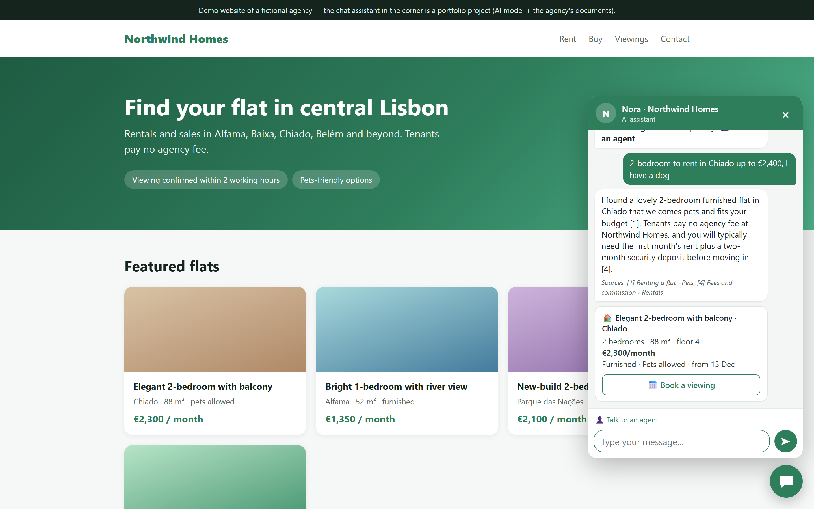
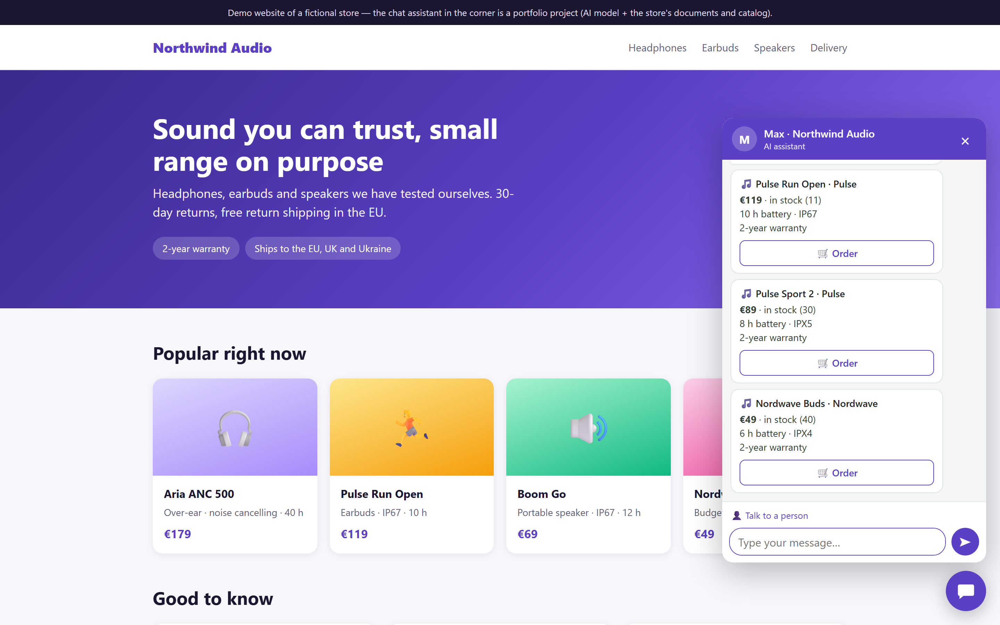

# Website chat widget

The same assistant as in Telegram (same engine, same two demo businesses) as a chat bubble on a website:
a FastAPI backend plus one `widget.js` file. No build step, no dependencies in the browser.

| Real estate demo | Online store demo |
|---|---|
|  |  |

Phone layout: [real estate](screens/widget_realty_mobile_2.png) · [store](screens/widget_shop_mobile_2.png).
Screenshots come from a run against the **live Gemini API** (details in [LIVE_TEST.md](LIVE_TEST.md)); data is fictional.

## Put it on a site

One tag, anywhere in the page:

```html
<script src="https://assistant.example.com/widget.js" data-color="#2e7d5b" data-lang="auto" defer></script>
```

| Attribute | Meaning | Default |
|---|---|---|
| `data-api` | base URL of the assistant API | where `widget.js` was loaded from |
| `data-color` | brand colour of bubble and header (`#rrggbb`); text colour is chosen for contrast | `#2e7d5b` |
| `data-title` | header title | assistant and business name from the server |
| `data-lang` | `en`, `uk` or `auto`: language of buttons and hints (the assistant answers in the visitor's language) | `auto` |
| `data-position` | `right` or `left` | `right` |
| `data-open` | `true` opens the chat on load | closed |

`window.AssistantWidget.open()` / `.close()` let the host page control it. The UI lives in a shadow root, so the
site's CSS cannot break it; on phones the chat opens full screen.

## Run it

```bash
pip install -r requirements.txt
cp .env.example .env              # VERTICAL=realty|shop, LLM_PROVIDER, GEMINI_API_KEY, ...
python -m app.web                 # http://127.0.0.1:8000/  (demo site of the configured business + the widget)
```

One server = one business (like one bot = one business); run two instances for two shops. Extra settings:

| Variable | Meaning |
|---|---|
| `WIDGET_ALLOWED_ORIGINS` | comma-separated sites that may embed the widget, e.g. `https://www.example.com`; empty = only this server's own pages |
| `ADMIN_API_KEY` | enables `/api/admin/*` (sent as `X-Admin-Key`); empty = admin API off |
| `IP_RATE_LIMIT_PER_HOUR` | per client IP (default 120), on top of `RATE_LIMIT_PER_HOUR` per visitor (default 30) |
| `HOST`, `PORT` | listen address (default `127.0.0.1:8000`) |
| `BOT_TOKEN` + `ADMIN_IDS` | optional: new website leads are also pushed to the admins' Telegram |

## API

| Endpoint | Purpose |
|---|---|
| `POST /api/chat` `{session_id, message}` | → `{status, reply, sources:[{n,title}], cards:[{id,title,lines,buttons}], handoff}`; `429` when a limit is hit |
| `POST /api/lead` `{session_id, action, phone, name?}` | `action` = `human` or a card button (`book:NH-103`, `order:NA-07`); saves the lead, notifies admins |
| `GET /api/config` | persona, welcome text, sample questions, lead prompts (the widget builds its UI from this) |
| `GET /api/health` | liveness + database check |
| `GET /api/admin/stats`, `GET /api/admin/leads.csv` | usage report (questions, hand-offs, leads, tokens, cost) and leads export; need `X-Admin-Key` |

No business logic is duplicated: `app/chat.py` (rate limit, history, conversation log, leads, usage report) is shared by
the Telegram bot and this API; the agent, retrieval, tools and guardrails are untouched.

## Safety and limits (what is and is not protected)

- Server text (including anything the model says) is inserted with `textContent`; the only `innerHTML` in `widget.js` is a
  constant icon. A test feeds the widget a hostile `` reply and checks that nothing runs.
- **CORS allowlist + `Origin` check:** browsers from other sites are refused. This protects visitors and the API budget
  from other *websites*; it is not authentication: a script can send requests without an `Origin` header. That is why
  there are also per-visitor and per-IP hourly limits and a message length cap (1,000 characters).
- The IP limiter is in memory (one process). Several processes or servers need a shared store such as Redis.
  Behind a reverse proxy keep uvicorn's `proxy_headers` on and trust only your proxy's address.
- Visitors are anonymous: a random session id in the browser's `localStorage`. Conversations are stored in the database
  with token counts; **there is no retention policy or consent banner yet**: add both before real customers use it.
- Not done: public hosting (the demo runs locally), HTTPS/reverse-proxy setup, load testing, Docker run.
- Not in this version: streaming answers, file upload, a live-agent inbox (the widget collects a phone number for a human
  to call back), one server serving several businesses.

## Tests

`tests/test_web.py` (API through httpx/ASGI: chat, cards, history per visitor, limits, failure path, leads, origin rules,
admin API, helpers) and `tests/test_widget_browser.py` (headless Chrome against the real server: ask → card → book →
lead arrives; phone screen and reload; embedding from another origin with attributes; hostile text stays inert).
The browser test is skipped when Playwright's Chromium is not installed (`playwright install chromium`).
